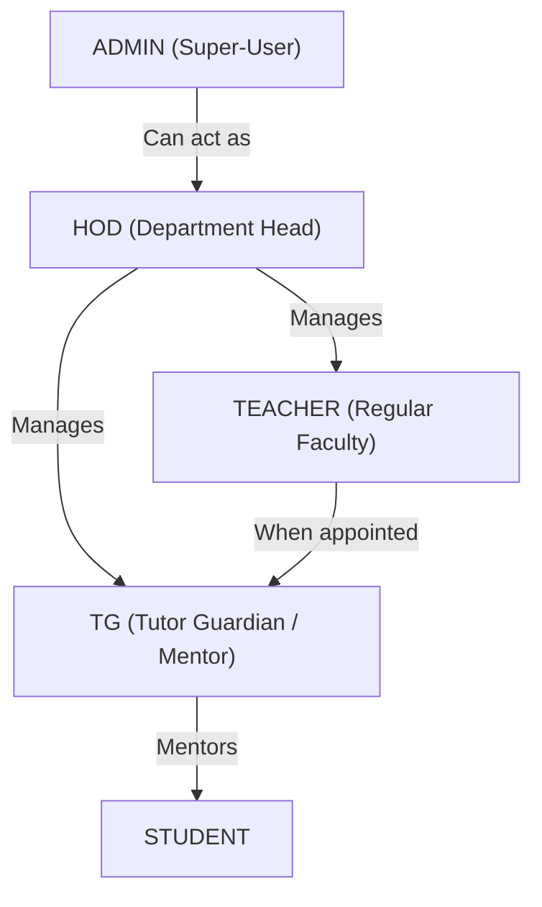
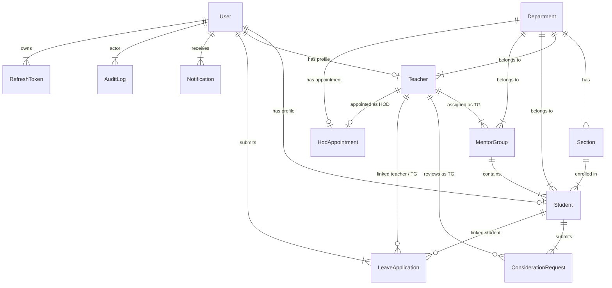
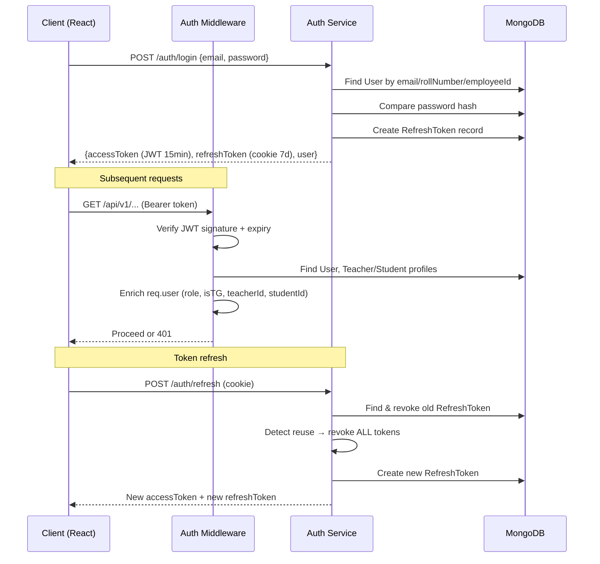
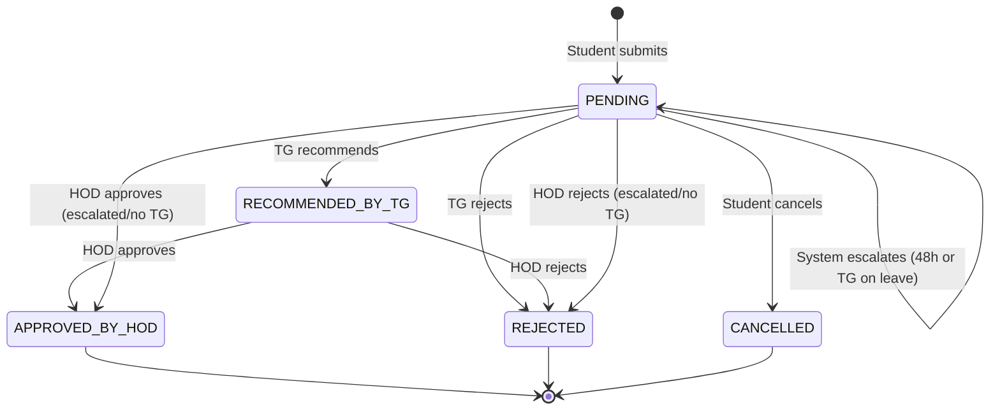
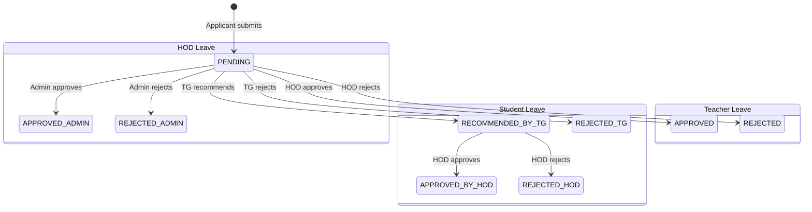
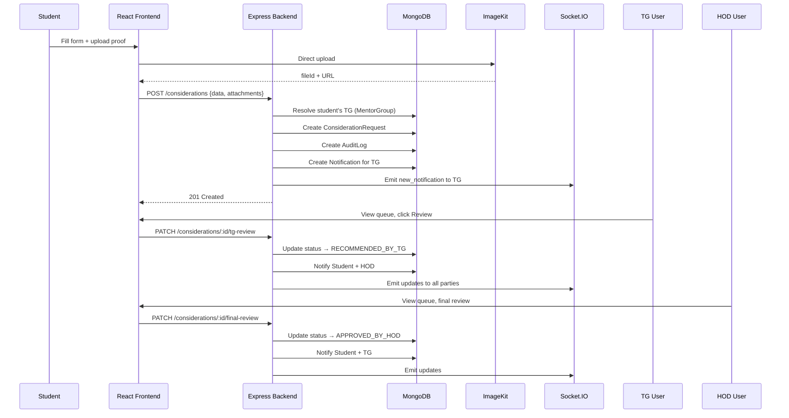
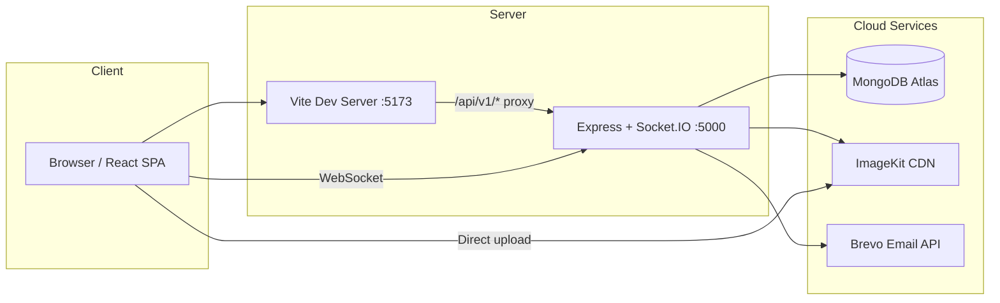
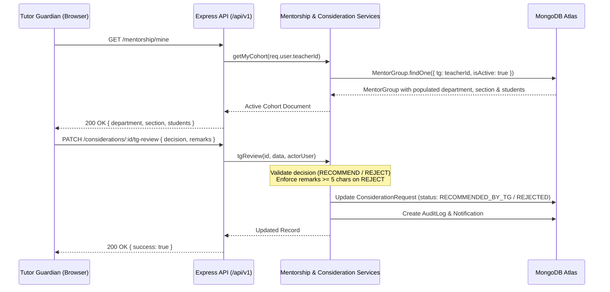

# CampusFlow Lite — System Architecture

> **Generated**: October 2026  
> **Scope**: Attendance consideration requests, leave applications, mentorship management  
> **NOT in scope**: Daily attendance marking, percentage calculations, timetable scheduling

---

## 1. Technology Stack

| Layer | Technology | Version |
|---|---|---|
| **Runtime** | Node.js (ESM modules) | — |
| **Backend Framework** | Express 5 | ^5.3.0 |
| **Database** | MongoDB Atlas (Mongoose 9) | ^9.11.1 |
| **Authentication** | JWT (access + refresh tokens) | jsonwebtoken ^9.0.3 |
| **Password Hashing** | bcryptjs (12 rounds) | ^3.0.3 |
| **Validation** | Zod 4 | ^4.6.6 |
| **Real-Time** | Socket.IO 4 | ^4.8.4 |
| **File Storage** | ImageKit (cloud CDN) | ^6.0.0 |
| **Email** | Brevo SDK + Nodemailer SMTP fallback | @getbrevo/brevo ^6.0.3, nodemailer ^10.1.0 |
| **Excel Reports** | ExcelJS | ^4.4.0 |
| **CRON Jobs** | node-cron | ^4.6.0 |
| **Frontend Framework** | React 18 + Vite 5 | react ^18.3.1, vite ^5.4.2 |
| **Routing** | React Router v6 | ^6.26.2 |
| **HTTP Client** | Axios | ^1.7.9 |
| **Icons** | Lucide React | ^1.16.0 |
| **Date Utilities** | date-fns 4 | ^4.1.0 / ^4.4.0 |
| **CSS** | Vanilla CSS (139 KB index.css) | — |

---

## 2. User Roles & Permissions

### 2.1 Role Hierarchy



### 2.2 Permissions Matrix

| Action | STUDENT | TEACHER | TG | HOD | ADMIN |
|---|:---:|:---:|:---:|:---:|:---:|
| Submit consideration request | ✅ | — | — | — | — |
| Submit leave application | ✅ | ✅ | ✅ | ✅ | — |
| View own requests/leaves | ✅ | ✅ | ✅ | ✅ | — |
| Cancel own PENDING request | ✅ | ✅ | ✅ | ✅ | — |
| TG review (recommend/reject) | — | — | ✅ | — | — |
| HOD final review (approve/reject) | — | — | — | ✅ | ✅ |
| Admin review (HOD leaves) | — | — | — | — | ✅ |
| View TG review queue | — | — | ✅ | — | — |
| View HOD review queue | — | — | — | ✅ | ✅ |
| List/view students | — | — | ✅ | ✅ | ✅ |
| Update student contact info | — | — | ✅ | ✅ | ✅ |
| Delete student records | — | — | — | ✅ | ✅ |
| Reassign student section/semester | — | — | — | ✅ | ✅ |
| List/manage teachers | — | — | — | ✅ | ✅ |
| Manage mentor groups (TG appointments) | — | — | — | ✅ | ✅ |
| Manage sections & academic master data | — | — | — | ✅ | ✅ |
| List/manage all users | — | — | — | ✅* | ✅ |
| Bulk import (Excel) | — | — | — | — | ✅ |
| View audit logs | — | — | — | ✅ | ✅ |
| Export reports (Excel) | — | — | ✅ | ✅ | ✅ |
| Upload attachments | ✅ | ✅ | ✅ | ✅ | ✅ |
| Self-registration | ✅ | ✅ | — | — | — |
| Dashboard summary | ✅ | ✅ | ✅ | ✅ | ✅ |

> \* HOD gets user management access through `authorize('ADMIN', 'HOD', 'TG')` on users routes

### 2.3 TG Role Derivation

TG is **not** a stored role. A TEACHER becomes a TG when:
1. A `MentorGroup` document exists with `tg = teacher._id` and `isActive = true`
2. The `auth` middleware detects this and sets `req.user.isTG = true`
3. The `authorize('TG')` middleware checks `req.user.isTG`

---

## 3. Database Schema (12 Mongoose Models)



### 3.1 Model Details

| Model | Key Fields | Indexes |
|---|---|---|
| **User** | name, email (unique), passwordHash (select:false), role (STUDENT/TEACHER/HOD/ADMIN), mustChangePassword, isActive, phone, profileImage, lastLoginAt | email, role |
| **Student** | user (ref→User, unique), department, section, rollNumber (unique), enrollmentNumber, enrollmentYear, guardianName, guardianPhone, mentorGroup | department, section, rollNumber, mentorGroup |
| **Teacher** | user (ref→User, unique), department, designation, employeeId (unique), specialization | department |
| **Department** | name, code (unique, uppercase) | — |
| **Section** | department, year (1-4), semester (1-8), name, code (unique, uppercase) | department |
| **MentorGroup** | department, tg (ref→Teacher), academicYear, semester, section, students[], isActive | tg+isActive compound |
| **ConsiderationRequest** | student, tg, eventTitle, eventType (enum), organizer, venue, startDate, endDate, requestedPeriods, selectedPeriods[], description, attachments[], status (enum), tgReview, hodReview, escalated, history[] | student+createdAt, tg+status, status+createdAt |
| **LeaveApplication** | applicant (ref→User), applicantRole, student, teacher, tg, leaveType (enum), startDate, endDate, totalDays, reason, attachments[], status (enum), tgReview, finalReview, escalated, history[] | applicant+startDate, tg+status, status+createdAt |
| **Notification** | user, title, message, type, link, isRead, readAt | user+isRead+createdAt |
| **AuditLog** | actor, action, entityType, entityId, before, after, ip, userAgent | entityType+entityId+createdAt |
| **RefreshToken** | user, tokenHash, expiresAt (TTL), revokedAt, userAgent, ip | user, tokenHash, expiresAt (TTL) |
| **HodAppointment** | department, teacher, startDate, endDate, isActive | department (partial unique on isActive:true) |

---

## 4. Backend Architecture

### 4.1 Module Structure

```
backend/src/
├── app.js                    # Express app setup, middleware, route mounting
├── server.js                 # HTTP server, Socket.IO init, cron init
├── config/
│   ├── env.js                # Zod-validated environment config
│   ├── db.js                 # MongoDB connection
│   ├── cors.js               # CORS options
│   ├── brevo.js              # Brevo email client factory
│   └── imagekit.js           # ImageKit client factory
├── middleware/
│   ├── auth.js               # JWT verification + user enrichment
│   ├── authorize.js          # Role-based access (supports derived TG role)
│   ├── errorHandler.js       # Centralized error handler
│   ├── rateLimit.js          # General (500/15min) + Auth (20/15min) limiters
│   └── validate.js           # Zod schema validation middleware
├── models/                   # 12 Mongoose schemas
├── modules/
│   ├── auth/                 # Login, register, refresh, logout, change-password, getMe
│   ├── considerations/       # CRUD + TG review + HOD review
│   ├── leaves/               # CRUD + TG review + HOD/Admin final review
│   ├── users/                # User CRUD + sections CRUD
│   ├── students/             # Student list/update/delete
│   ├── teachers/             # Teacher list/update
│   ├── mentorship/           # MentorGroup CRUD + student assignment
│   ├── reports/              # Dashboard summary + Excel export
│   ├── notifications/        # List/mark-read notifications
│   ├── uploads/              # ImageKit auth params, verify, signed URLs
│   ├── import/               # Excel bulk import (students/teachers)
│   └── audit/                # Audit log listing
├── jobs/
│   └── escalation.job.js     # Hourly cron: escalate stale PENDING requests
├── sockets/
│   ├── index.js              # Socket.IO server + JWT auth handshake
│   └── emitters.js           # Event emitters (notifications, queue changes)
├── utils/
│   ├── ApiError.js           # Custom error class with static factories
│   ├── asyncHandler.js       # Express async wrapper
│   ├── dates.js              # IST date helpers, overlap checks
│   ├── pagination.js         # Page/limit/skip parser
│   ├── response.js           # Standardized { success, data, meta } response
│   └── sendEmail.js          # Brevo → SMTP → console fallback email sender
└── seed/
    └── seed.js               # Database seeder
```

### 4.2 API Routes Summary

| Route Prefix | Auth | Roles | Key Endpoints |
|---|:---:|---|---|
| `POST /api/v1/auth/login` | ❌ | Public | Login with email/rollNumber/employeeId |
| `POST /api/v1/auth/register/student` | ❌ | Public | Self-registration |
| `POST /api/v1/auth/register/teacher` | ❌ | Public | Self-registration |
| `POST /api/v1/auth/refresh` | ❌ | Public | Rotate refresh token |
| `POST /api/v1/auth/logout` | ✅ | Any | Revoke refresh token |
| `POST /api/v1/auth/change-password` | ✅ | Any | Change own password |
| `GET /api/v1/auth/me` | ✅ | Any | Get current user profile |
| `GET/POST /api/v1/considerations/*` | ✅ | STUDENT, TG, HOD, ADMIN | Full consideration lifecycle |
| `GET/POST /api/v1/leaves/*` | ✅ | STUDENT, TEACHER, HOD, ADMIN | Full leave lifecycle |
| `GET/POST /api/v1/users/*` | ✅ | HOD, ADMIN, TG | User management |
| `GET/POST /api/v1/sections/*` | ✅ | HOD, ADMIN | Section management |
| `GET/PATCH /api/v1/students/*` | ✅ | HOD, ADMIN, TG | Student management |
| `GET/PATCH /api/v1/teachers/*` | ✅ | HOD, ADMIN | Teacher management |
| `GET/POST/PUT/DELETE /api/v1/mentor-groups/*` | ✅ | HOD, ADMIN, TG | Mentorship management |
| `GET /api/v1/dashboard/summary` | ✅ | Any | Role-specific dashboard stats |
| `GET /api/v1/reports/*` | ✅ | HOD, ADMIN, TG | Paginated reports + Excel export |
| `GET /api/v1/notifications/*` | ✅ | Any | Notification list + mark-read |
| `GET/POST/DELETE /api/v1/uploads/*` | ✅ | Any | ImageKit auth + signed URLs |
| `GET/POST /api/v1/import/*` | ✅ | HOD, ADMIN | Bulk import from Excel |
| `GET /api/v1/audit` | ✅ | HOD, ADMIN | Audit trail listing |
| `GET /api/v1/health` | ❌ | Public | Health check |

---

## 5. Authentication & Authorization Flow



### Key Security Features
- **Refresh token rotation** with reuse detection (revokes all tokens on replay)
- **SHA-256 hashed** refresh tokens stored in DB
- **HTTP-only cookies** for refresh tokens
- **Rate limiting**: 20 login attempts / 15 min, 500 general requests / 15 min
- **Helmet** security headers
- **bcrypt** with 12 salt rounds

---

## 6. Core Business Workflows

### 6.1 Consideration Request Lifecycle



### 6.2 Leave Application Lifecycle



**Approval chains**:
- Student → TG → HOD
- Teacher → HOD
- HOD → ADMIN

### 6.3 Escalation System

- **Cron job** runs every hour (`0 * * * *`)
- Escalates PENDING requests/leaves when:
  1. Created > `ESCALATION_HOURS` (default 48h) ago
  2. Assigned TG is on approved leave today
- Sets `escalated = true`, adds SYSTEM history entry
- Notifies HOD/ADMIN users
- Escalated items appear in HOD queue alongside recommended items

---

## 7. Frontend Architecture

### 7.1 State Management

Single `ERPContext` (React Context API) manages:
- Authentication state (`token`, `currentUser`, `currentRole`, `isAuthenticated`)
- Notification state (`notifications`, `unreadNotifCount`)
- Toast notifications (auto-dismiss in 5s)
- Modal state (`activeModal`, `modalData`)
- File preview with signed URLs
- Socket.IO connection lifecycle

### 7.2 Page Structure

```
frontend/src/
├── pages/
│   ├── auth/          # LoginPage, ChangePasswordPage, StudentRegisterPage, TeacherRegisterPage
│   ├── student/       # Dashboard, MyRequests, Considerations, Leaves, Profile
│   ├── tg/            # Dashboard, Requests, MyStudents
│   ├── teacher/       # Dashboard, Leaves
│   ├── hod/           # Dashboard, Considerations, Leaves, Mentorship, Students, Teachers, Reports
│   └── admin/         # Dashboard, Users, BulkImport, HodLeaves, Audit
├── components/
│   ├── Header.jsx     # Top nav with notifications
│   ├── Sidebar.jsx    # Role-based navigation
│   ├── common/        # Badge, Button, Card, StatCard, Table, EmptyState, etc.
│   └── modals/        # 13 modal components for various actions
├── layouts/
│   └── DashboardLayout.jsx  # Sidebar + Header + content
├── context/
│   └── ERPContext.jsx       # Global state provider
└── api/
    ├── client.js            # Axios instance with JWT interceptor + auto-refresh
    ├── authApi.js            
    ├── considerationApi.js   
    ├── leaveApi.js           
    └── modulesApi.js         # Dashboard, reports, mentorship, masterData, uploads, notifications
```

### 7.3 Route Protection

- `ProtectedLayout` — redirects unauthenticated users to `/login`
- `RoleRouteGuard` — enforces role-based access per route
- `LoginWrapper` — redirects authenticated users to their dashboard
- Forced password change: redirects to `/change-password` if `mustChangePassword = true`

---

## 8. Real-Time Communication

### Socket.IO Rooms
| Room Name | Members | Events Received |
|---|---|---|
| `user_{userId}` | Individual user | `new_notification` |
| `role_{ROLE}` | All users with role | `queue_changed` |
| `tg_{teacherId}` | Specific TG | `request_updated` |

### Events
| Event | Direction | Payload | Trigger |
|---|---|---|---|
| `new_notification` | Server → Client | Notification object | Any status change |
| `request_updated` | Server → Client | `{kind, id, status}` | Review/cancel action |
| `queue_changed` | Server → Client | `{kind, scope}` | Queue contents change |

---

## 9. External Integrations

### 9.1 ImageKit (File Storage)
- **Purpose**: Store proof documents (PDFs, images) for considerations and leaves
- **Flow**: Client gets auth params → uploads directly to ImageKit → backend verifies fileId
- **Signed URLs**: 5-minute expiry for secure viewing
- **Limits**: 5 MB max, PDF/JPG/PNG only

### 9.2 Brevo (Email)
- **Purpose**: Transactional emails for status notifications, OTP verification
- **Fallback chain**: Brevo SDK → SMTP (Nodemailer) → Console simulation
- **Status**: API key is empty in `.env` → currently using console simulation

### 9.3 MongoDB Atlas
- **Cluster**: `cluster0.xpdtrvr.mongodb.net`
- **Database**: `attendance_leave_db`
- **Connection**: Mongoose with retry writes

---

## 10. Data Flow Diagrams

### 10.1 Consideration Request Flow



---

## 11. Security Considerations

| Area | Implementation |
|---|---|
| **Transport** | Helmet headers, CORS allowlist |
| **Authentication** | JWT access (15min) + refresh (7d) with rotation |
| **Token Storage** | Access → localStorage, Refresh → httpOnly cookie |
| **Password Security** | bcrypt 12 rounds, Zod validation (8+ chars, uppercase, number) |
| **Rate Limiting** | express-rate-limit (general + auth-specific) |
| **File Upload** | MIME type validation, 5MB limit, user-path ownership check |
| **Authorization** | Middleware-level role checks, resource ownership validation |
| **Audit Trail** | Immutable AuditLog with before/after snapshots |
| **Input Validation** | Zod schemas on request bodies |
| **Self-Review Prevention** | Cannot review own consideration/leave applications |

---

## 12. Deployment Topology



- **Frontend**: Vite dev server on port 5173 with API proxy to backend
- **Backend**: Express HTTP + Socket.IO on port 5000
- **Database**: MongoDB Atlas (cloud)
- **File CDN**: ImageKit (cloud)
- **Email**: Brevo transactional API (cloud)

---

## 13. Tutor Guardian (TG) Subsystem Architecture & Governance

### 13.1 TG Workspace Component Hierarchy

```
frontend/src/
├── pages/tg/
│   ├── TgDashboard.jsx         # Executive metrics, active TG duty chips, quick actions, clearance ledger modal trigger
│   ├── TgRequests.jsx          # Tier-1 review queue for student considerations and leaves with tabbed status filters
│   └── TgMyStudents.jsx        # Assigned cohort student roster, search bar, read-only cohort badge, student cards
├── components/
│   ├── Sidebar.jsx             # TG Workspace navigation: Dashboard, Review Queue, My Students (Faculty Portal excluded)
│   ├── Header.jsx              # Single canonical Teacher Dashboard button for faculty dual-role access
│   ├── common/Badge.jsx        # WCAG AAA status indicators with automatic icons (Clock, XCircle, CheckCircle2)
│   └── modals/
│       ├── ReviewModal.jsx     # High-contrast Recommend to HOD and Reject buttons with focus rings
│       ├── EditStudentModal.jsx# Read-only HOD-assigned Semester and Section; allows updating contact info only
│       └── OfficialClearancesLedgerModal.jsx # Read-only scope in TG mode (isTgView=true); live API bindings without mock data
```

### 13.2 Frontend-to-Backend Data Flows



### 13.3 HOD-Controlled Configuration & Governance Rules

1. **Cohort Scope Immutability**:
   - A Tutor Guardian is designated by the HOD for a specific Section and Semester (stored in `MentorGroup`).
   - The TG cannot change, filter, or reassign sections or departments.
   - All dropdown controls that previously allowed selecting department, semester, or section in the TG interface have been removed and replaced with static, read-only HOD-assigned badges.
2. **Student Deletion Restriction**:
   - TGs do NOT possess administrative authority to delete student records from the college ERP.
   - `DELETE /api/v1/students/:id` is strictly protected by `authorize('HOD', 'ADMIN')`. Attempted deletion requests by TG return `403 Forbidden`.
   - The `Delete` button has been removed from `TgMyStudents.jsx`.
3. **Terminology Standardization**:
   - All user-facing terminology strictly uses "Student" and "Students" ("My Students", "Student List", "Total Students", "No Students Found", "Review Student Requests").
   - Internal database attributes (`MentorGroup.students`, `Student.mentorGroup`) and API routes remain intact to preserve full backward compatibility.
4. **Accessible Visual Contrast**:
   - "Recommended by TG" badges use high-contrast amber styling (`#78350F` on `#FEF3C7` with `#F59E0B` border, >7:1 ratio) with a `Clock` icon.
   - "Rejected" badges use high-contrast rose styling (`#881337` on `#FFE4E6` with `#F43F5E` border, >8:1 ratio) with an `XCircle` icon.
   - Review modal action buttons provide prominent borders, active color fills, and keyboard focus rings.

---

## 14. Removed & Deprecated Modules (Scope Alignment)

In strict accordance with the approved departmental ERP Lite scope, the system has been streamlined around **three primary user roles**:
1. **HOD (Head of Department)**
2. **TG (Tutor Guardian / Mentor)**
3. **Student**

### 14.1 Deprecated Teacher Portal & Dual-Role Workflows
- **Removed User-Facing Elements**:
  - Legacy Teacher Dashboard (`/teacher`) and Teacher Leaves (`/teacher/leaves`) routes have been deprecated and redirected to the TG Workspace (`/tg` and `/tg/requests`).
  - The "Switch to Faculty / TG Portal" button and the secondary "Teacher Dashboard" header link have been removed from `Header.jsx`.
  - Public teacher registration (`/register/teacher`) has been removed from public access and redirects to student registration (`/register`). Faculty members are onboarded exclusively by Department Administration.
  - The "Faculty" tab has been removed from `LoginPage.jsx`.
- **Preserved Internal Data Models**:
  - `Teacher.js`, `MentorGroup.js`, and faculty relations in `LeaveApplication.js` are preserved internally to support teacher leave approvals by HOD, mentorship mapping, and audit trails without data loss.

### 14.2 Out-of-Scope Attendance Modules
- **Excluded Functionality**:
  - Daily attendance marking, period-by-period roll calls, percentage calculators, and biometrics/timetable generation are strictly out of scope.
  - The system focuses exclusively on **Attendance Consideration Requests** (formal requests by students for sanctioned attendance credit due to approved hackathons, sports, cultural events, or academic duties) and **Student & Faculty Leave Applications**.

---

## 15. Remaining Limitations & Verified Environment Boundaries

| Component | Status | Operational Boundary / Verification Note |
|---|:---:|---|
| **Transactional Email Service** | Simulated / Fallback | `sendEmail.js` is wired and functional with console logging. Live Brevo / SMTP delivery activates when credentials are supplied in production `.env`. |
| **ImageKit Cloud Storage** | Mock / Live Proxy | ImageKit SDK handles direct uploads and signed view URLs. In offline testing, signed URLs generate mock verification tokens. |
| **Escalation Job** | Verified Active | Hourly CRON job scans for requests pending $>48\text{h}$ or assigned to TGs on approved leave, escalating them to HOD queues with audit entries. |
| **Multi-Department Scoping** | Enforced | HOD consideration and leave queues filter by `targetDepartment = user.departmentId`. Super-admin users retain global visibility. |


